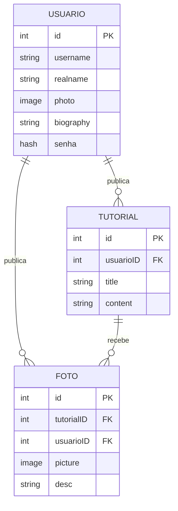

# Projeto X — Plataforma de Divulgação de Tutoriais Manuais

> Nome provisório usado pelo time de desenvolvimento até a definição do nome final.

## 1. Visão Geral

Projeto X é uma plataforma onde usuários publicam tutoriais de trabalhos manuais (crochê, pintura, marcenaria, etc.). Qualquer usuário pode seguir o tutorial de outra pessoa e, como comprovação, publicar uma foto do resultado dentro do próprio tutorial original. Isso cria um ciclo de inspiração: um tutorial não é só uma postagem estática, mas acumula uma galeria de resultados feitos por outros usuários.

**Conceitos-chave:**
- **Usuário**: quem publica tutoriais e/ou fotos de resultados.
- **Tutorial**: uma postagem de instrução, escrita por um usuário.
- **Foto**: o registro do resultado de um usuário que seguiu um tutorial (pode ser de um usuário diferente do autor do tutorial).

---

## 2. Modelo de Dados

### 2.1 Entidade `Usuario`

| Campo       | Tipo    | Restrições                                      |
|-------------|---------|--------------------------------------------------|
| id          | int/uuid | chave primária                                   |
| username    | string  | máx. 10 caracteres, apenas alfanuméricos, `_` e `.`, único |
| realname    | string  | máx. 100 caracteres                              |
| photo       | image   | foto de perfil                                   |
| biography   | string  | máx. 1000 caracteres                             |
| senha       | hash    | armazenada como hash (nunca em texto puro)       |

### 2.2 Entidade `Tutorial`

| Campo      | Tipo    | Restrições                          |
|------------|---------|---------------------------------------|
| id         | int/uuid | chave primária                       |
| usuarioID  | FK → Usuario | autor do tutorial                |
| title      | string  | máx. 100 caracteres                  |
| content    | string  | conteúdo/instruções do tutorial      |

### 2.3 Entidade `Foto`

| Campo       | Tipo    | Restrições                                  |
|-------------|---------|-----------------------------------------------|
| id          | int/uuid | chave primária                               |
| tutorialID  | FK → Tutorial | tutorial ao qual a foto pertence         |
| usuarioID   | FK → Usuario  | autor da foto (quem seguiu o tutorial)   |
| picture     | image   | imagem do resultado                          |
| desc        | string  | máx. 1000 caracteres                         |

### 2.4 Relacionamentos

```
Usuario 1 ──── N Tutorial
Usuario 1 ──── N Foto
Tutorial 1 ──── N Foto
```

- Um **Usuario** pode ter vários **Tutoriais**.
- Um **Usuario** pode ter várias **Fotos** (mesmo em tutoriais de outros autores).
- Um **Tutorial** pode ter várias **Fotos** associadas, postadas por diferentes usuários.

> **Observação:** o autor do tutorial e o autor da foto podem ser a mesma pessoa (ex: postar a foto do próprio resultado) ou pessoas diferentes (o caso principal de uso da plataforma).
### 2.5 Diagrama


---

## 3. Rotas da API

Todas as rotas são de API pura (JSON — sem renderização de páginas). `-` indica rota que exige autenticação (usuário logado).

| Método | Rota                            | Auth | Descrição                                                          |
|--------|-----------------------------------|:----:|------------------------------------------------------------------------|
| POST   | `/login`                          |      | Autentica o usuário (cria sessão/token)                               |
| POST   | `/registrar`                      |      | Cria uma nova conta de usuário                                        |
| GET    | `/tutoriais`                      |      | Lista os tutoriais (feed da página inicial); aceita `?search=` por título |
| POST   | `/tutoriais`                      |  ✔   | Cria um novo tutorial (usuário logado é o autor)                      |
| GET    | `/tutoriais/:tutorialID`          |      | Retorna um único tutorial (mesmo formato do item da listagem)         |
| DELETE | `/tutoriais/:tutorialID`          |  ✔   | Remove um tutorial (apenas o autor)                                   |
| GET    | `/fotos/:usuarioID`               |      | Lista as fotos postadas por um usuário específico                     |
| GET    | `/fotos/tutorial/:tutorialID`     |      | Lista as fotos de resultado de um tutorial específico                 |
| POST   | `/fotos/:tutorialID`              |  ✔   | Posta uma foto de resultado vinculada a um tutorial                    |
| DELETE | `/fotos/:fotoID`                  |  ✔   | Remove uma foto (apenas o autor)                                      |
| GET    | `/usuarios`                       |      | Lista/busca usuários; aceita `?search=` por username                  |
| GET    | `/usuarios/:usuarioID`            |      | Retorna um único usuário (mesmo formato do item da listagem)          |
| PATCH  | `/usuarios`                       |  ✔   | Edita os dados do próprio usuário logado                              |

---

## 4. Fluxo da Aplicação

A aplicação é organizada em **3 abas principais** de navegação:

1. **Página Inicial**
2. **Pesquisar**
3. **Eu**

As páginas de **usuário**, **tutorial** e **fotos** não são abas — são alcançadas por navegação a partir dessas 3 abas (ex: ao clicar em um card).

### 4.1 Página Inicial
- Mostra o feed de **tutoriais** (`GET /tutoriais`).
- Ao clicar em um tutorial, o usuário acessa a **página do tutorial**, onde pode:
  - Ler o conteúdo completo do tutorial.
  - Acessar o **perfil do usuário** que postou o tutorial.
  - Ver as **fotos** de quem já seguiu aquele tutorial (galeria de resultados).

### 4.2 Página de Usuário
- Acessível a partir de um tutorial (autor) ou de uma foto (autor) ou da busca.
- Mostra:
  - Dados do perfil (nome, foto, biografia).
  - Lista de **tutoriais** publicados por esse usuário.
  - Lista de **fotos** publicadas por esse usuário (resultados de tutoriais que seguiu).

### 4.3 Pesquisar
- Permite buscar:
  - **Usuários** pelo `username`.
  - **Tutoriais** pelo `title`.
- Resultados levam às respectivas páginas de detalhe.

### 4.4 Eu
- Se **logado**: mostra o perfil do próprio usuário (mesma estrutura da página de usuário, mas com opções de edição — chama `PATCH /usuarios`).
- Se **não logado**: mostra a tela de **login** / **cadastro**, que envia os dados para `POST /login` / `POST /registrar` respectivamente.

### 4.5 Diagrama de navegação simplificado

```
[Página Inicial] --clica em tutorial--> [Tutorial]
                                            |--> [Usuário (autor)]
                                            |--> [Fotos do tutorial]

[Pesquisar] --busca usuário--> [Usuário]
            --busca tutorial--> [Tutorial]

[Eu] --logado--> [Meu Perfil] --editar--> (PATCH /usuarios)
     --não logado--> [Login] / [Registrar]
```

---

## 5. Resumo do Escopo

| Funcionalidade                          | Rota                              |
|------------------------------------------|-------------------------------------|
| Cadastro de usuário                       | `POST /registrar`                  |
| Login                                     | `POST /login`                      |
| Publicar tutorial                         | `POST /tutoriais`                  |
| Listar tutoriais / buscar por título      | `GET /tutoriais`                   |
| Ler um tutorial específico                | `GET /tutoriais/:tutorialID`       |
| Remover tutorial                          | `DELETE /tutoriais/:tutorialID`    |
| Postar foto de resultado em um tutorial   | `POST /fotos/:tutorialID`          |
| Ver fotos de um usuário                   | `GET /fotos/:usuarioID`            |
| Ver fotos de um tutorial                  | `GET /fotos/tutorial/:tutorialID`  |
| Remover foto                              | `DELETE /fotos/:fotoID`            |
| Listar usuários / buscar por username     | `GET /usuarios`                    |
| Ver perfil de um usuário específico       | `GET /usuarios/:usuarioID`         |
| Editar perfil                             | `PATCH /usuarios`                  |
